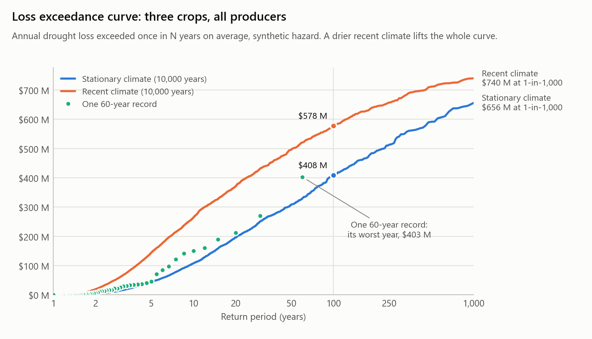
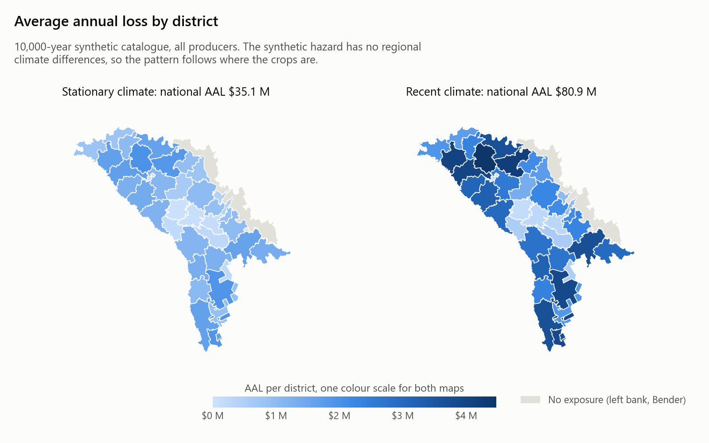
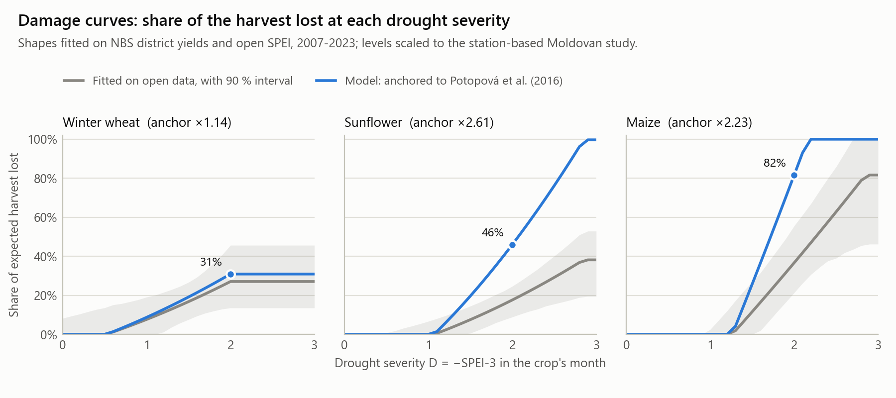

# Moldova drought loss

> A catastrophe-risk model of agricultural drought in Moldova, built on
> [CLIMADA](https://github.com/CLIMADA-project/climada_python): drought hazard × crop exposure ×
> yield-loss curves gives loss, for winter wheat, sunflower and maize in 35 districts. It reports
> Average Annual Loss, the loss exceedance curve, loss by district, the effect of a drier recent
> climate, and a parametric insurance cover with its basis risk measured against recorded yields.
> **The drought hazard behind the loss figures is synthetic**, calibrated to open data only.

## Results

The crops' value, at expected yield and recent producer prices, is **$918 M** for all producers
($700 M on commercial farms). On a 10,000-year synthetic catalogue:

| All producers, US$ M | Stationary climate | If 2001–2023 summers are the new normal |
|---|---|---|
| **Average annual loss (AAL)** | **35.1** (3.8 % of exposure) | **80.9** (8.8 %) |
| 1-in-10-year loss | 108 | 264 |
| 1-in-100-year loss | 408 | 578 |
| 1-in-250-year loss | 514 | 657 |

<picture>
  <source media="(prefers-color-scheme: dark)" srcset="docs/img/exceedance-dark.png">
  
</picture>

- **A drier recent climate more than doubles the risk.** Since 2001, summer SPEI-3 has run 0.3 to
  0.6 standard deviations below its 1950–2023 normal, and because crop loss starts only past a
  threshold and then climbs steeply, that shift raises AAL 2.3-fold.
- **An index cover works for the country, not for the district.** Backtested against recorded
  yields for 2007–2023, even the best payout rule misses 22 % of severe district losses, and at
  district level a drought index can remove at most a third of the loss variance. Added up
  nationally, payouts and losses correlate at 0.66.
- **Shape matters more than sophistication.** A ramp from SPEI-3 = −1.0 to −2.0 beats both a
  binary trigger at −1.5 (which misses 37 % of severe losses) and a payout shaped like the
  model's own damage curve.
- **Priced on the long-run climate, the cover would have lost money.** Its pure premium is $35 M
  a year in a stationary climate and $77–81 M in the recent one; on the 2007–2023 index it would
  have paid $136–153 M a year.

<picture>
  <source media="(prefers-color-scheme: dark)" srcset="docs/img/district-map-dark.png">
  
</picture>

## What it does

```
download        geoBoundaries districts, NBS crop statistics, FAOSTAT prices (pinned by SHA-256)
synthetic       monthly SPEI for 16 stations, calibrated to open CSIC SPEI
hazard          SPEI-3 in each crop's window at 37 district centroids -> one CLIMADA hazard per crop
exposure        value of each crop's expected harvest per district
vulnerability   yield-loss curve per crop, fitted on NBS yields, anchored to the literature
loss            CLIMADA impacts -> year loss table -> AAL, exceedance curve, loss by district
parametric      payout rules backtested on recorded yields and priced on the catalogues
figures         the three figures in this README, light and dark, from the outputs above
```

Each stage is a command, `python -m drought_loss <stage>`, and each writes its results to
`data/processed`, except `figures`, which writes to `docs/img`.

## Scope

- **One peril, one country, three crops.** Agricultural drought in Moldova, for winter wheat,
  sunflower and maize: about $918 M of annual crop value. Barley, soy, sugar beet, vegetables,
  orchards and vineyards are outside it.
- **Districts on the right bank of the Nistru.** NBS statistics exclude the left bank and Bender,
  so those two of geoBoundaries' 37 units carry hazard but no exposure.
- **Two tracks.** This repository uses a synthetic hazard and open data only. The same pipeline
  runs unchanged on licensed station data in a separate private repository; those results are not
  published, and a test and the command line both refuse to let them land here.

## Method

### Synthetic hazard

SPEI is standard normal in every calendar month by definition, so the generator works in that
space directly rather than simulating rainfall and standardising it:

- **Space:** monthly SPEI-1 is a Gaussian field with correlation exp(−distance / 605 km) between
  Moldova's 16 meteorological stations.
- **Time:** AR(1) with lag-1 autocorrelation 0.103.
- **SPEI-3:** the three-month sum of SPEI-1 divided by its exact standard deviation, so it is
  exactly N(0, 1) in every month.

Both parameters are fitted by `python -m drought_loss calibrate <folder>` to 18 cells of CSIC's
Global 0.5° SPEI database over Moldova (per-location exports from
[spei.csic.es](https://spei.csic.es/database.html), downloaded November 2023, January 1950 to
September 2023), never to station records. The range is fitted on April–August, the months behind
the crop windows: summer rain is patchier, and an all-month fit (about 740 km) would overstate
summer correlation.

| August SPEI-3 at the same cells | Open cells (74 years) | Generator (20,000 years) |
|---|---|---|
| Mean correlation between cells | 0.804 | 0.810 |
| Years with half the cells at or below −1.5 | 0.081 (6 years) | 0.055 |

### Crop-season hazard

`python -m drought_loss hazard <station SPEI CSV>` makes one CLIMADA hazard per crop, with one
event per year at each district:

- **Crop window.** SPEI-3 at the end of each crop's drought-sensitive period in Moldova
  (Potopová et al. 2016): June for winter wheat, July for sunflower, August for maize.
- **Severity.** D = max(0, −SPEI-3), so zero means no drought, as CLIMADA's sparse intensity and
  its exceedance tools expect.
- **From stations to districts.** Simple kriging under the generator's correlation model, divided
  by the prediction's standard deviation. Averaging correlated N(0, 1) values shrinks extremes,
  and with a convex loss curve that would understate loss. A station missing in a year is left
  out of that year only.
- **Probability.** Each year is one event with probability 1 / (number of years): the record is
  treated as a sample of one climate.

Each hazard folder records the SPEI file it came from (`provenance.json`), so later stages can
tell private results from public ones.

### Exposure

`python -m drought_loss exposure`: value = sown area × expected yield × scale-up to all
producers × producer price.

| Factor | Source and rule | Why |
|---|---|---|
| Sown area | NBS, mean of 2021–2025 | Today's farms, held fixed against every hazard year (an "as-if" exposure). |
| Expected yield | NBS, median of 2016–2025, years with sown area only | A median is not dragged down by the drought years this model is about. |
| Scale-up | NBS national all-producer production ÷ the district table's national total | The district table covers farms of 10 ha or more only. |
| Price | FAOSTAT producer price, mean of 2020–2024, nominal US$ | Smooths the 2021–2022 spike without ignoring it. |

| Crop | Scale-up | US$/t | Commercial farms | All producers |
|---|---|---|---|---|
| Maize | 2.05 | 181 | $145 M | $298 M |
| Sunflower | 1.13 | 464 | $343 M | $385 M |
| Winter wheat | 1.11 | 179 | $212 M | $234 M |
| **Total** | | | **$700 M** | **$918 M** |

Households grow a third of Moldova's maize but almost none of its sunflower or wheat. The 35
districts add up to the NBS national row (to 0.1 %), and expected production lies between the
worst and best years of 2016–2025, 8–12 % above the average year.

### Impact functions

`python -m drought_loss vulnerability --cells <folder>` fits one curve per crop on NBS yields for
35 districts against SPEI-3 from the open cells, 2007–2023:

- **Yield anomaly.** Each district's yield over its own Theil–Sen trend, minus 1. Yields rose
  3–4 % a year, so a fixed baseline would count old technology as drought.
- **Curve.** anomaly = a + b·SPEI + c·SPEI², the second-order polynomial Potopová et al. (2016)
  fitted for Moldova.
- **Loss.** The fitted shortfall below trend at SPEI = −D, the way crop insurance measures loss
  against an expected yield. A worse drought never loses less, and past the largest severity in
  the data the curve stays flat.
- **Uncertainty.** Refits on 1,000 resamples of whole years, because districts in one year share
  its weather.
- **Level anchored to the literature.** Fitted on gridded SPEI, the curves come out flatter than
  station-based ones (regression dilution: noise in a predictor flattens a fitted slope). Each
  fitted shape is scaled until its mean loss over years with SPEI-3 ≤ −1 equals Potopová et al.
  (2016, Table 6): 0.188 wheat, 0.223 sunflower, 0.305 maize. Loss is capped at the whole
  harvest, so the factor is found by root-finding.

| Crop | Fitted: loss at D = 1.5 / 2.0 (90 % interval) | Anchor | **Model: loss at D = 1.5 / 2.0** | AAL ratio, fitted → model |
|---|---|---|---|---|
| Winter wheat | 0.17 (0.08–0.27) / 0.27 (0.14–0.46) | ×1.14 | **0.19 / 0.31** | 3.1 % → 3.5 % |
| Sunflower | 0.08 (0.01–0.15) / 0.18 (0.09–0.25) | ×2.61 | **0.20 / 0.46** | 1.4 % → 3.5 % |
| Maize | 0.12 (0.00–0.27) / 0.37 (0.21–0.56) | ×2.23 | **0.26 / 0.82** | 2.4 % → 4.8 % |

<picture>
  <source media="(prefers-color-scheme: dark)" srcset="docs/img/damage-curves-dark.png">
  
</picture>

Loss is measured from the trend yield, not from a "normal-climate" yield: the trend was set in a
dry decade, so loss starts only at a severity of about 1. Measuring from a normal-climate yield
would lean on the few wet years (maize's include 2021, 80 % over trend) and roughly triple the
maize AAL. The drier recent climate is handled in the hazard instead, below. Around the curves,
yields scatter with a standard deviation of 0.23–0.45 of trend, shared between districts in the
same year (correlation 0.5–0.7).

### Loss

`python -m drought_loss loss <hazard folder>` runs each crop through CLIMADA, then builds the annual
view from a year loss table (every year, crop and district):

- **AAL** is the mean annual loss; crops' AALs add up to the total.
- **Exceedance curve**, from each year's total over all crops (the aggregate view: one dry year
  hits all three), with CLIMADA's rule that the k-th largest of N years has return period N / k.
  A test checks it gives the same numbers as CLIMADA's own curve.
- **No return period beyond the record.** CLIMADA would return the worst year for any longer one.

| All producers (commercial in brackets) | 60-year record | 10,000-year catalogue |
|---|---|---|
| **AAL** | $39.9 M ($30.5 M), 90 % interval $24–56 M | **$35.1 M ($25.8 M)** |
| 1-in-10 years | $150 M | $108 M ($80 M) |
| 1-in-20 | $212 M | $196 M ($138 M) |
| 1-in-50 | $359 M | $308 M ($225 M) |
| 1-in-100 / 1-in-250 | not reported | $408 M / $514 M |
| Worst year | $403 M | $739 M (80 % of exposure) |

- **One 60-year record is noisy**: its AAL is 14 % above the catalogue's, inside the interval
  from resampling its years.
- **The pieces agree.** Each crop's loss ratio in the catalogue (3.51 / 3.43 / 4.56 %) matches its
  curve's analytic AAL ratio under standard-normal SPEI (3.55 / 3.54 / 4.84 %) within sampling
  noise, and CLIMADA's losses equal a direct computation from the same severity to six decimals.
- **Diversification shows in the tail**: at 1-in-100 the crops' separate losses add up to $522 M,
  against $408 M for their annual total.
- **District ranking reflects exposure only**: the synthetic hazard has no regional climate
  differences, so the districts with the largest AAL are the ones with the most crop value.

### Current-climate sensitivity

`python -m drought_loss hazard <csv> --climate recent` shifts each crop month's SPEI-3, at every
district after interpolation, to its 2001–2023 mean in the open cells: −0.31 for June (wheat),
−0.41 for July (sunflower) and −0.59 for August (maize), each with a standard error of about 0.2.

| All producers | Stationary | Recent climate | Ratio |
|---|---|---|---|
| **AAL** | $35.1 M | **$80.9 M** | ×2.3 |
| Maize / sunflower / wheat AAL | $13.6 / 13.2 / 8.2 M | $39.6 / 28.4 / 13.0 M | ×2.9 / ×2.2 / ×1.6 |
| 1-in-10 / 1-in-100 / 1-in-250 | $108 / 408 / 514 M | $264 / 578 / 657 M | ×2.5 / ×1.4 / ×1.3 |

A third to a half of a standard deviation more than doubles AAL, because loss only starts at a
severity of about 1 and then climbs steeply. With each shift one standard error wetter or drier,
AAL is $60 M or $111 M; even the wetter end is far above the stationary $36 M. Only maize's shift
is clearly beyond year-to-year noise.

### Parametric cover and basis risk

`python -m drought_loss parametric --cells <folder> --catalogue <hazard folder> ...` pays on each
district's SPEI-3 in the crop's window. Three payout rules are each scaled so their expected
payout equals the crop's modelled AAL, so they cost the same:

| Rule | Pays | Wheat | Sunflower | Maize |
|---|---|---|---|---|
| Binary | a fixed share of insured value when SPEI-3 ≤ −1.5 | 53 % | 53 % | 72 % |
| Ramp | from nothing at SPEI-3 = −1.0 to a limit at −2.0 | 48 % | 47 % | 65 % |
| Curve | the model's own damage curve | | | |

Basis risk is measured against what happened: each rule is backtested against the yield shortfall
NBS recorded in 35 districts over 2007–2023, with SPEI from the open cells as the index (595
district-years per crop). Comparing payouts with modelled losses from the same index would show
almost no basis risk, by construction.

| All three crops | Binary | Ramp | Curve |
|---|---|---|---|
| Severe district losses (≥ 30 % below trend) with no payout, of 322 | 37 % | **22 %** | 22 % |
| Payouts on districts with little loss (< 10 %) | 29 % | 39 % | 38 % |
| Correlation of payout and loss, district / national | 0.53 / 0.66 | **0.58 / 0.66** | 0.56 / 0.65 |
| Hedge effectiveness, district / national | −0.31 / 0.15 | **0.14 / 0.32** | −0.35 / 0.07 |
| Payouts ÷ recorded losses | 1.31 | 1.17 | 1.31 |

- **At district level, basis risk is large whatever the design.** Correlations of 0.34–0.62 by crop
  mean even a perfectly sized payout removes at most 11–38 % of a district's loss variance. SPEI-3
  in one month misses frost, wet years, pests and drought outside the window; recorded losses count
  them all.
- **It shrinks nationally**, because one district's noise offsets another's: the case for covers
  held by a government or an aggregator rather than by each farm.
- **The binary cliff edge is the worst design** (58 % of severe wheat losses missed). The ramp
  beats the curve: the most model-like payout pays most where an index error costs most.
- **Hedge effectiveness can fall below zero with positive correlation**, because it judges size as
  well as timing: these covers paid more than the recorded losses, and a fifth or more of payouts
  went to districts with little loss.

| US$ M, all three crops | Expected payout | Payout std. dev. | 1-in-10 payout | 1-in-100 payout |
|---|---|---|---|---|
| Binary, stationary / recent | 35.0 / 80.7 | 80 / 124 | 127 / 274 | 390 / 500 |
| Ramp, stationary / recent | 35.4 / 76.5 | 71 / 106 | 124 / 242 | 333 / 428 |
| Curve, stationary / recent | 35.1 / 80.9 | 79 / 129 | 108 / 264 | 408 / 578 |

The expected payout is the pure premium, before costs and capital. On the 2007–2023 index the
covers would have paid $136–153 M a year, more than even the recent-climate price; that decade
began with the 2007 drought and the backtest index is gridded, so the comparison is rough, but a
cover priced on a long-run average in a drying climate loses money. The ramp's limit also gives
the insurer the smallest payout tail.

## Known limitations

**The hazard is synthetic.** It reproduces the open cells' correlation and drought frequency, but
it is a model of Moldova's drought, not a record of it. The loss figures show how the method
behaves and how sensitive its answer is; they are not a measurement of Moldova's real risk.

**The yield-loss curves are the weakest link.**

- Their level is borrowed: fitted on gridded SPEI they are flattened by regression dilution, so
  each is scaled to Potopová et al. (2016), which is national, for 1962–2012. One number per crop
  sets loss in money, and its own uncertainty is not quantified.
- 17 years of yields with about five severe droughts stand behind each fit.
- Winter wheat's curve stops at D = 1.98, the driest June in 2007–2023; harsher wheat droughts get
  that loss, although 2007's national wheat loss of 50 % suggests more. *Leans low.*
- The yields are commercial farms' (10 ha or more); household maize may respond differently.

**Climate.**

- The baseline is stationary; summers since 2001 have been drier. The sensitivity measures that
  with a mean shift, not a projection, assuming spread and spatial pattern stay the same. *The
  stationary figures lean low for today's climate.*
- Joint droughts are Gaussian: the generator has fewer nationwide drought years than observed
  (5.5 % against 8.1 %), though 74 years cannot settle the gap. *Leans low in the tail.*
- The open cells are smoother than stations, so the fitted correlation is probably too high.
  *Leans high in the tail.*
- One persistence value for all months, although observed month-to-month persistence varies.

**Exposure.**

- Smallholders are placed like large farms; the scale-up assumes household maize is spread across
  districts like commercial maize.
- Prices are held fixed; a national harvest failure can raise them and soften the loss in money.
  *Leans high.* Loss in money scales one for one with the price assumption.
- Three crops only, and nothing for the left bank or Bender.

**Hazard detail.** Each district gets SPEI at one point, its centroid, from one month per crop.

**Parametric cover.** One index point per district, no deductibles, loadings or reinsurance
structure, and the same 17 years behind the backtest.

## Data

| Input | Source | Licence | How it is pinned |
|---|---|---|---|
| District boundaries | [geoBoundaries](https://www.geoboundaries.org) ADM1, Moldova, commit 9469f09 | CC BY 3.0 IGO | SHA-256 in `config.py` |
| Crop statistics | National Bureau of Statistics of the Republic of Moldova, [statbank.statistica.md](https://statbank.statistica.md), tables AGR020600reg and AGR020060 | CC BY 4.0 | SHA-256 of the API response |
| Producer prices | FAO, FAOSTAT Producer Prices | CC BY 4.0 | SHA-256 of Moldova's rows |
| SPEI for calibration | CSIC Global SPEI database, 18 cells over Moldova | Open Database License | fitted values in `config.py`, re-derived by data tests |
| Yield-loss anchor | Potopová et al. 2016, Int. J. Climatol. 36:2063, Table 6 | published values | in `vulnerability.py` |

`python -m drought_loss download` fetches the first three, retrying politely when a server asks
it to wait. Nothing is used until its SHA-256 matches the pin; a source that revises its data
stops the run and leaves the new file beside the old one as `.unverified`. The CSIC cells are
not downloadable by the pipeline: point `calibrate`, `vulnerability`, `parametric` and the data
tests at their folder.

## Outputs

Everything lands in `data/processed` (git-ignored):

| Path | Contents |
|---|---|
| `exposure.csv` | each district and crop's area, expected yield, scale-up, price and value |
| `synthetic_spei_<N>y_seed<S>.csv` | synthetic monthly SPEI-1 and SPEI-3 per station |
| `hazard_*/` | one CLIMADA hazard per crop (`.hdf5`), severity tables, `provenance.json` |
| `loss_*/` | `year_loss_table.csv` (every year, crop and district) and `aal_by_district.csv` |
| `vulnerability_open_cells.csv` | fitted and anchored curves with their 90 % intervals |
| `parametric/` | `backtest.csv` (basis-risk measures) and `pricing.csv` |

`figures` draws the README's figures from those outputs into `docs/img`, which is committed: a
light and a dark PNG of each, and it refuses outputs whose provenance names private data.

## Reproducibility

On 6 November 2026 the repository was rebuilt from a fresh clone: an environment created from
`environment.lock.txt` (6 minutes), every input downloaded again, and every stage run (8
minutes). All four downloads matched their pinned SHA-256, the 138 tests passed, and all 37
output files matched the original run: 28 byte for byte, and the 9 CLIMADA hazard files, which
store write metadata, through their identical severity tables and the byte-identical losses
computed from them. Calibration, the impact functions and the backtest also need the CSIC cell
workbooks, which are not distributed with the repository.

## Environment

CLIMADA needs compiled GDAL, which pip cannot build on Windows, so the environment comes from
conda-forge through [micromamba](https://mamba.readthedocs.io/en/latest/installation/micromamba-installation.html),
a single executable that changes nothing on your system. `environment.yml` holds the loose
requirements and `environment.lock.txt` the exact package URLs and checksums that were tested
(Windows 64-bit only). The package is installed with `--no-deps`, so pip never re-resolves what
conda installed. The environment sits outside the repository because a conda prefix must not
contain spaces; `scripts\dev_env.ps1` activates it.

If the repository is on exFAT, git reports "dubious ownership" because that file system records
no owner. Allow the folder once:

```bash
git config --global --add safe.directory "F:/Drought Loss Moldova CLIMADA"
```

## Quick start

### Environment on Windows (PowerShell)

These commands use `F:\`; on another drive with 5 GB free, set `$env:MAMBA_ROOT_PREFIX` and
`$env:DROUGHT_LOSS_ENV` to match.

```powershell
# Once: micromamba (check it against the .sha256 file published beside it) and the environment
New-Item -ItemType Directory -Force F:\micromamba | Out-Null
Invoke-WebRequest -UseBasicParsing -OutFile F:\micromamba\micromamba.exe `
    -Uri https://github.com/mamba-org/micromamba-releases/releases/latest/download/micromamba-win-64
$env:MAMBA_ROOT_PREFIX = "F:\micromamba"
F:\micromamba\micromamba.exe create -y -p F:\envs\drought-loss -f environment.lock.txt   # 7-14 min

# In every new window, then once after the first activation:
. .\scripts\dev_env.ps1
python -m pip install -e . --no-deps

# Only if you have the open SPEI cells (see Data):
$cells = "F:\Trifan PhD data\Database_SPEI_NUTS"
$env:DROUGHT_LOSS_OPEN_SPEI = $cells
```

### Environment on Linux or macOS (conda)

Not yet run end to end off Windows. On 6 November 2026 `environment.yml` solved for linux-64,
osx-64 and osx-arm64 (a micromamba dry run) to the same CLIMADA, GDAL, NumPy and Python versions
as the Windows lock file, but there is no lock file for these platforms, so other packages may
differ from the tested set.

```bash
# Once (mamba or micromamba read the same file):
conda env create -f environment.yml
conda activate drought-loss
python -m pip install -e . --no-deps

# Only if you have the open SPEI cells (see Data):
cells="$HOME/spei-cells"
export DROUGHT_LOSS_OPEN_SPEI="$cells"
```

### Run the pipeline (either shell)

Forward slashes work in both PowerShell and bash.

```bash
# Inputs and exposure
python -m drought_loss download
python -m drought_loss exposure

# The 60-year record and the 10,000-year catalogue (about 1.5 minutes)
python -m drought_loss synthetic --years 60
python -m drought_loss hazard data/processed/synthetic_spei_60y_seed42.csv --out data/processed/hazard_60y
python -m drought_loss loss data/processed/hazard_60y --out data/processed/loss_60y
python -m drought_loss synthetic --years 10000
python -m drought_loss hazard data/processed/synthetic_spei_10000y_seed42.csv --out data/processed/hazard_10000y
python -m drought_loss loss data/processed/hazard_10000y --out data/processed/loss_10000y

# The current-climate sensitivity
python -m drought_loss hazard data/processed/synthetic_spei_10000y_seed42.csv --out data/processed/hazard_10000y_recent --climate recent
python -m drought_loss loss data/processed/hazard_10000y_recent --out data/processed/loss_10000y_recent

# With the open SPEI cells: calibration, impact functions, the parametric cover, the figures
python -m drought_loss calibrate "$cells"
python -m drought_loss vulnerability --cells "$cells"
python -m drought_loss parametric --cells "$cells" --catalogue data/processed/hazard_10000y --catalogue data/processed/hazard_10000y_recent
python -m drought_loss figures

# Tests
pytest                                  # everything; data tests skip without the cells
pytest -m "not climada and not data"    # fast tests only
pytest -m data                          # needs DROUGHT_LOSS_OPEN_SPEI
```

## Repository layout

```
environment.yml         loose requirements
environment.lock.txt    exact tested versions (Windows 64-bit)
pyproject.toml          package metadata, pytest, ruff and mypy settings
climada.conf            keeps CLIMADA's data in data/climada, not in the home folder
src/drought_loss/       the package
  __main__.py           command line: download | synthetic | hazard | exposure | vulnerability |
                        loss | parametric | figures | calibrate
  config.py             paths, pinned inputs (SHA-256), stations, fitted parameters
  downloads.py          fetching with polite retries; nothing is used until its SHA-256 matches
  synthetic.py          the synthetic SPEI generator, its calibration, the recent-climate shift
  open_spei.py          reader for the open SPEI cell workbooks
  spei_input.py         checks station SPEI on the way in; keeps private results out of here
  boundaries.py         district boundaries: download, verify, centroids
  hazard.py             crop-season severity per district, the CLIMADA hazard, provenance
  nbs.py                NBS crop statistics through the PX-Web API, and the district crosswalk
  fao.py                FAOSTAT producer prices for Moldova
  exposure.py           crop value per district, its reconciliation, CLIMADA exposures
  vulnerability.py      yield anomalies, the curve fit and anchor, CLIMADA impact functions
  loss.py               CLIMADA impacts, year loss table, AAL, exceedance curve, districts
  parametric.py         payout rules, fair pricing, backtest and basis-risk measures
  figures.py            the README's figures, light and dark, from the public outputs only
tests/                  pytest suite (markers: `climada` loads CLIMADA, `data` needs the cells,
                        `raw` needs data/raw)
scripts/dev_env.ps1     prepares a PowerShell window
docs/img/               the README's figures
data/                   downloaded inputs and generated outputs (git-ignored)
```

## Licence

Code: MIT (see `LICENSE`). Data keeps its source licence, listed under Data. Crop statistics:
Source: National Bureau of Statistics of the Republic of Moldova; the model converts their units
and combines them as described under Exposure. The fitted numbers in `config.py` are a produced
work of CSIC's Global SPEI database (Beguería et al. 2014, Int. J. Climatol. 34:3001;
Vicente-Serrano et al. 2010, J. Climate 23:1696), made available under the Open Database License.

## Verdict

**A drought index can price Moldova's crop-drought risk; it cannot insure a single district
against it.**

Run on a synthetic hazard calibrated to open data, the model puts the three crops' drought loss at
$35 M a year in a stationary climate and about $81 M if the last two decades' summers are the new
normal, with a 1-in-100-year loss of $408–578 M against $918 M of crop value. The drier climate is
the biggest single lever in the model, bigger than any choice about the cover.

The backtest against recorded yields is the sobering part. Even the best payout rule misses a
fifth of severe district losses, and at district level SPEI-3 can remove at most a third of the
loss variance. Added up nationally, the same payouts track the country's loss well enough to be
worth holding, so a ramp-shaped cover held by a government or an aggregator, priced on the recent
climate rather than the long-run average, is the design this model supports.

The weakest link is the yield-loss curve: its level is borrowed from one station-based study, and
one number per crop moves every loss figure with it.

## What the numbers mean

- **Average annual loss (AAL)** is the yearly cost of drought averaged over many years, good and
  bad. It is what you would have to set aside each year to break even in the long run: here $35 M,
  about 3.8 % of the crops' value. Most years lose far less, a few lose far more.
- **Return period.** A "1-in-100-year loss" is a loss exceeded in 1 % of years on average. It is a
  probability, not a schedule: it can happen twice in a decade, and over 30 years there is a 26 %
  chance of seeing at least one.
- **Exceedance curve.** Loss plotted against return period: for each loss, how often a year that
  bad or worse comes along. This model adds all three crops up within each year first, because
  one dry summer hits them together.
- **PML (probable maximum loss)** is the loss at a chosen return period, typically 1-in-100 or
  1-in-250: here $408 M and $514 M. Insurers and governments use it to size capital and
  reinsurance. PMLs do not add up across crops or districts the way AALs do, because their worst
  years are not all the same year.
- **Basis risk** is the gap between what an index cover pays and what was actually lost. It runs
  both ways: a farmer whose crop failed for a reason the index did not see gets nothing, and a
  district that came through fine can still be paid. Here, at the best design, 22 % of severe
  district losses went unpaid and 39 % of payouts went to districts that lost little.
- **Hedge effectiveness** is how much of the year-to-year swing in losses a cover removes: 1 is a
  perfect match, 0 no better than no cover, below 0 worse than none.
- **Pure premium** is the cover's expected payout per year, before the insurer's costs and its
  charge for holding the capital: the floor under any real price.
